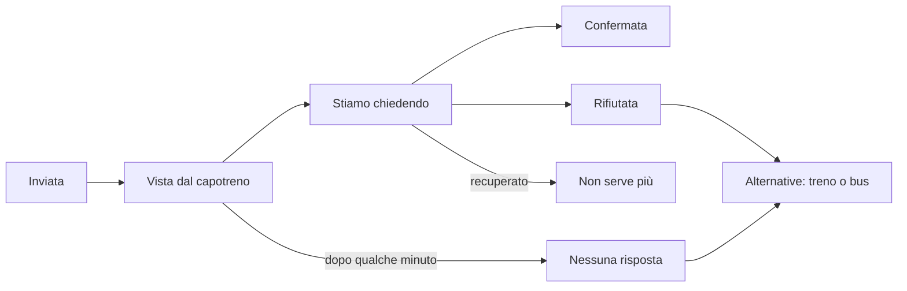

# Piano prodotto: app Coincidenze

26 novembre 2026 · Stefano (con Claude)

Versione condivisa e commentabile: https://claude.ai/artifact/DDvLyMzyjmaZCRa2CdCWyR

## In breve

La proposta: costruiamo prima un prototipo gratuito, che si apre dal telefono come un'app, su un solo viaggio vero (Bevilacqua → Monselice → Ferrara), con due ruoli: viaggiatore e capotreno. Costo: 0 €.

1. **Cosa fa l'app.** Il viaggiatore sceglie il viaggio, vede quanto margine ha davvero per il cambio, sa in che carrozza stare, e con un bottone avvisa il capotreno. Il capotreno vede le richieste del suo treno e risponde. Se la coincidenza salta, l'app propone l'alternativa.
2. **Perché questo e non tutto subito.** La ricerca dice che il punto debole è uno: la richiesta parte solo se qualcuno parla, e la risposta non torna mai indietro. Il prototipo deve provare che questo si può risolvere.
3. **I dati.** Orari e ritardi veri si possono leggere gratis ma in modo non ufficiale. Posizione delle carrozze e turni dei capotreni non sono pubblici: nel prototipo li inseriamo noi a mano.
4. **Gli app store.** Non servono adesso. L'app si installa dal sito, come un'icona sul telefono. Gli store (Google 25 $ una volta, Apple 99 $ all'anno) solo se il progetto va avanti.
5. **Tempi.** Circa 6 settimane, con 1 o 2 giorni a settimana a testa.

Le parti segnate con **[IPOTESI]** sono mie supposizioni, da verificare.

## Il problema, dalla nostra ricerca

Il viaggio si rompe al cambio, e non per colpa del ritardo: l'informazione per decidere esiste già nel servizio, ma non arriva al viaggiatore. Fonti: user journey di Stefano (24 novembre 2026) e intervista ad Andrea, capostazione a Ferrara.

1. **L'informazione arriva tardi.** A bordo si legge il ritardo di adesso, non il ritardo previsto all'arrivo a Monselice. Il treno spesso recupera, ma lo scopri solo quando scendi.
2. **La richiesta parte solo se qualcuno parla.** A volte il viaggiatore ferma il capotreno, a volte è il capotreno a chiedere chi deve cambiare, a volte nessuno dice niente. Senza richiesta, nessuno trattiene il treno.
3. **I nove minuti non sono nove minuti.** Arrivi al binario 6, riparti dal binario 1. Il margine vero è 9 minuti meno l'attraversamento della stazione (non ancora misurato).
4. **La risposta non torna indietro.** Il viaggiatore non sa se il treno lo aspetterà finché non scende.
5. **Se la coincidenza salta, non c'è un piano.** I treni regionali passano ogni ora: perderne uno costa un'ora di giornata.

Come funziona oggi la catena (dall'intervista): viaggiatore → capotreno → telefonata al capostazione della stazione di cambio → se sono pochi minuti decide lui, altrimenti serve il Dirigente Centrale di Bologna. Tutto a voce e al telefono. La coincidenza non è un diritto: è una cortesia.

La nostra app lavora quindi nei 37 minuti a bordo del primo treno, quando la decisione è ancora possibile.

## I ruoli: chi usa l'app e cosa vede

Una sola app, con una schermata diversa per ogni ruolo. Quando entri scegli (o ti viene assegnato) il tuo ruolo.

| Ruolo | Cosa vede | Cosa può fare | Quando |
| --- | --- | --- | --- |
| **Viaggiatore** | Il suo viaggio, il margine reale del cambio, la carrozza consigliata, lo stato della sua richiesta | Scegliere il viaggio, avvisare il capotreno, vedere le alternative | Subito (prototipo) |
| **Capotreno del treno in arrivo** | La sua agenda dei turni, il treno di oggi, le richieste di coincidenza dei passeggeri a bordo, raggruppate per stazione di cambio | Rispondere "sto chiedendo", "confermata", "rifiutata"; chiamare il capostazione | Subito (prototipo) |
| **Capostazione della stazione di cambio** | I treni in arrivo nella sua stazione, quante persone devono cambiare e su quale treno | Dire "trattengo" o "non trattengo"; scegliere un binario più vicino | Dopo (seconda versione) |
| **Capotreno del treno in coincidenza** | Che il suo treno potrebbe dover aspettare qualche minuto, e per quante persone | Solo leggere | Dopo |
| **Dirigente Centrale** | Le attese lunghe che servono il suo benestare | Approvare o no | Fuori dal prototipo: è dentro i sistemi di RFI |
| **Regia (noi del gruppo)** | Tutto | Inventare ritardi e scenari per fare i test | Subito, solo per il prototipo |

Attori della actors map che lasciamo fuori per ora: Sala Blu e assistenza PMR, bus sostitutivi, biglietteria, Polfer. Si possono aggiungere dopo, se i test lo chiedono.

**[IPOTESI]** La "Regia" non è un ruolo vero: è il nostro pannello per simulare i ritardi durante i test, perché non possiamo aspettare che un treno ritardi davvero.

## I flussi principali, passo per passo

### Flusso A. Il viaggiatore sceglie il viaggio

1. Apre l'app e scrive da dove parte e dove deve arrivare (come sul sito di Trenitalia).
2. L'app mostra le soluzioni con i cambi. Per ogni cambio indica il margine sulla carta (es. 9 minuti) e il **margine reale**: 9 minuti meno il tempo per andare dal binario 6 al binario 1.
3. Il viaggiatore sceglie la soluzione e la salva come "il mio viaggio". Se è un pendolare, la salva una volta e la ritrova ogni mattina.

### Flusso B. A bordo: quanto manca e quanto rischio

1. Sul primo treno l'app mostra il **ritardo previsto all'arrivo** alla stazione di cambio, non solo il ritardo di adesso.
2. Mostra un semaforo: verde (ce la fai), giallo (stretto), rosso (rischi di perderlo).
3. Mostra la **carrozza consigliata**: "Stai nella carrozza di testa: a Monselice scendi vicino al sottopasso".
4. Quando il semaforo diventa giallo o rosso, compare il bottone **"Avvisa il capotreno"**.

### Flusso C. La richiesta al capotreno e la sua risposta

Questo è il cuore dell'app. Ogni richiesta ha uno stato che il viaggiatore vede sempre sul suo schermo, mentre aspetta:

1. **Inviata.** Il viaggiatore preme il bottone. Vede: "Richiesta inviata al capotreno del treno 6.44. In attesa di risposta".
2. **Vista.** Il capotreno ha aperto la richiesta. Il viaggiatore vede: "Il capotreno ha letto la tua richiesta".
3. **Stiamo chiedendo.** Il capotreno ha chiamato il capostazione di Monselice. Il viaggiatore vede: "Il capotreno sta chiedendo alla stazione di Monselice".
4. Poi una di queste tre risposte:
    1. **Confermata.** "Il treno per Bologna ti aspetta. Scendi e vai al binario 1".
    2. **Rifiutata.** "Il treno per Bologna non può aspettare". Si apre subito il flusso D.
    3. **Non serve più.** Il treno ha recuperato: "Arrivi in tempo, nessuna attesa necessaria".
5. **Senza risposta.** Se dopo qualche minuto nessuno risponde, il viaggiatore lo vede scritto, e l'app gli prepara già le alternative. **[IPOTESI]** Il limite di minuti è da decidere insieme.

Ogni passaggio compare sullo schermo del viaggiatore mentre aspetta: anche un no, o nessuna risposta, porta subito alle alternative.

Il capotreno, dal suo lato, vede le richieste raggruppate: "Monselice, treno per Bologna 7.30: 4 persone". Risponde una volta per tutte e 4.

### Flusso D. Coincidenza persa: l'alternativa

1. L'app mostra il prossimo treno per la stessa destinazione (es. Monselice → Ferrara alle 8.27).
2. Mostra anche altre strade, se ci sono: un cambio diverso, un bus.
3. Dice a che ora arriverai a destinazione con ogni alternativa.
4. **[IPOTESI]** Nel prototipo le alternative sono inserite a mano da noi per il viaggio di prova.

### Flusso E. Il capotreno e la sua agenda

1. Il capotreno apre l'app e vede la sua agenda: i turni della settimana, con i treni di ogni turno.
2. Tocca il treno di oggi e vede le richieste di coincidenza in arrivo.
3. Risponde come nel flusso C.

## Le schermate

Il prototipo ha 11 schermate. Le altre 4 vengono dopo.

| N. | Schermata | Ruolo | Nel prototipo? |
| --- | --- | --- | --- |
| 1 | Benvenuto e scelta del ruolo | Tutti | Sì |
| 2 | Cerca il viaggio (da, a, ora) | Viaggiatore | Sì, solo il viaggio di prova |
| 3 | Soluzioni con margine reale dei cambi | Viaggiatore | Sì |
| 4 | Il mio viaggio, in corso: semaforo, ritardo previsto, carrozza consigliata | Viaggiatore | Sì |
| 5 | Bottone "Avvisa il capotreno" e conferma | Viaggiatore | Sì |
| 6 | Stato della richiesta (inviata, vista, stiamo chiedendo, confermata, rifiutata) | Viaggiatore | Sì |
| 7 | Alternative se la coincidenza salta | Viaggiatore | Sì, inserite a mano |
| 8 | Agenda dei turni | Capotreno | Sì, con turni inventati |
| 9 | Richieste del treno di oggi, raggruppate per cambio | Capotreno | Sì |
| 10 | Risposta alla richiesta | Capotreno | Sì |
| 11 | Regia: scegli il ritardo, fai partire uno scenario | Noi del gruppo | Sì |
| 12 | Treni in arrivo e persone che cambiano | Capostazione | Dopo |
| 13 | Avviso "forse aspetti qualche minuto" | Capotreno del treno in coincidenza | Dopo |
| 14 | Mappa della stazione di cambio con il percorso tra i binari | Viaggiatore | Dopo |
| 15 | Viaggi salvati e notifica del mattino | Viaggiatore | Dopo |

## Il problema dei dati: cosa c'è gratis e cosa simuliamo

Per il prototipo non serve nessun dato "vero": bastano i dati di un solo viaggio, scritti da noi. I dati veri servono solo se il progetto va oltre il prototipo. Le voci qui sotto le ho scritte a memoria: sono tutte **[IPOTESI] da verificare** prima di contarci.

| Dato | Esiste gratis? | Cosa facciamo nel prototipo |
| --- | --- | --- |
| Orari dei treni | Sì. Gli orari programmati si trovano in formato aperto ("GTFS", un file con tutti gli orari) per molte regioni. Da verificare se c'è la linea Padova–Bologna. | Scriviamo a mano gli orari del viaggio di prova (circa 20 righe) |
| Ritardo in tempo reale | Solo in modo non ufficiale: il sito ViaggiaTreno di Trenitalia si può leggere, ma non è un servizio garantito e può smettere di funzionare | Il ritardo lo decide la Regia. Facoltativo: mostrare anche quello vero, come prova |
| Ritardo previsto all'arrivo | No. Lo conoscono solo capotreno e Dirigente Centrale | Lo calcola la Regia, o lo inserisce il capotreno di prova |
| Binario di arrivo e partenza | Parziale: si vede sui tabelloni, poco prima | Lo scriviamo noi (binario 6 e binario 1) |
| Tempo per attraversare la stazione | No. Nessuno lo ha misurato | **Lo misura Stefano a Monselice**, col cronometro, 3 volte |
| Posizione delle carrozze rispetto alle scale | No. Non è pubblico | **Lo osserviamo noi**: dove si ferma la testa del treno, dove sono le scale |
| Turni dei capotreni | No. Sono dati interni dell'impresa | Inventiamo 2 settimane di turni per un capotreno di prova |
| Bus alternativi | Sì per molte aziende di trasporto locale (orari aperti). Da verificare per Monselice e Ferrara | Scriviamo a mano 2 o 3 alternative |

Il punto importante: nella vita vera il capotreno non installerà un'app esterna senza l'accordo di Trenitalia e RFI. Il nostro prototipo serve a **mostrare e provare l'idea**, non a sostituire i loro sistemi. **[IPOTESI]** Il progetto è un lavoro di studio, non un'azienda.

## Il prototipo (MVP): cosa facciamo prima e cosa rimandiamo

Facciamo prima la parte che la ricerca indica come rotta: la richiesta che arriva al capotreno e la risposta che torna al viaggiatore.

**Nel prototipo:**

1. Un solo viaggio: Bevilacqua 6.44 → Monselice (cambio di 9 minuti) → Ferrara.
2. Due ruoli veri: viaggiatore e capotreno.
3. Flussi B, C, D, E completi; flusso A semplificato (il viaggio di prova è già pronto da scegliere).
4. Margine reale e carrozza consigliata, con i dati che misuriamo noi.
5. Lo stato della richiesta, aggiornato da solo sullo schermo del viaggiatore.
6. La Regia, per far partire i ritardi durante i test.

**Rimandato a dopo:**

1. Ricerca libera di qualsiasi viaggio in Italia (richiede dati veri e un motore che calcola i percorsi).
2. Schermate del capostazione e del capotreno del treno in coincidenza.
3. Notifiche sul telefono anche ad app chiusa.
4. Accesso con nome utente e password (nel prototipo si sceglie il ruolo e basta).
5. App negli store di Google e Apple.

**Come capiamo se funziona.** Lo facciamo provare a 5-10 pendolari e, se riusciamo, a 1 o 2 capotreni. Domande: hanno capito il margine reale? Hanno premuto il bottone? Si sono sentiti più tranquilli mentre aspettavano la risposta?

## Quanto costa ogni strada

Il prototipo costa 0 €: usa gli stessi servizi gratuiti che usiamo già per il sito (Vercel per pubblicarlo, Supabase per il database). Prezzi a memoria, **[IPOTESI] da ricontrollare** prima di pagare qualsiasi cosa.

| Strada | Costo | Cosa ottieni | Quando ha senso |
| --- | --- | --- | --- |
| **App dal sito, installabile sul telefono** (consigliata) | 0 € | Si apre da un link, si aggiunge alla schermata Home come un'icona, funziona su Android e iPhone | Adesso, per prototipo e test |
| Nome del sito personalizzato (es. coincidenze.it) | circa 10-15 € all'anno | Un indirizzo più facile da dare ai tester | Facoltativo |
| App su Google Play | 25 $ una volta sola | L'app si scarica dallo store Android | Solo se dopo i test vogliamo un'app "vera" |
| App su Apple App Store | 99 $ all'anno | L'app si scarica dallo store iPhone | Solo se c'è un partner o un premio che lo giustifica |
| Dati in tempo reale ufficiali | Da negoziare con Trenitalia o RFI | Ritardi affidabili | Solo con un accordo con l'impresa |

Limiti del gratuito da conoscere: Supabase si mette in pausa se nessuno lo usa per una settimana (si riaccende con un clic); Vercel gratuito è pensato per progetti non commerciali, il che va bene per un lavoro di studio.

## La tabella di marcia, divisa tra noi tre

Sei settimane, 1 o 2 giorni a settimana a testa. Il codice lo scrive Claude; noi tre raccogliamo i dati, disegniamo e testiamo. La divisione dei compiti è una **[IPOTESI]**: cambiatela pure. Se si parte lunedì 30 novembre, le vacanze di Natale cadono tra la settimana 4 e la 5: contate una pausa.

| Settimana | Stefano | Benedetta | Beatrice | Risultato |
| --- | --- | --- | --- | --- |
| 1 | Prende le 5 decisioni in fondo con le altre due | Prepara e fa l'intervista a un capotreno (le domande sono già nella actors map) | Raccoglie 2 o 3 app di viaggio da cui prendere spunto (Trenitalia, Italo, app tedesca DB) | Decisioni prese, intervista fissata |
| 2 | A Monselice: cronometra 3 volte binario 6 → binario 1; fotografa dove si ferma la testa del treno e dove sono le scale | Scrive i turni inventati del capotreno di prova e le alternative al viaggio | Disegna su carta o in Figma le 11 schermate | Dati del viaggio di prova pronti, schermate disegnate |
| 3 | Rivede con Claude i dati e le schermate | Riporta cosa ha detto il capotreno e corregge i flussi | Sistema le schermate dopo l'intervista | Claude costruisce la prima versione dell'app |
| 4 | Prova l'app sul suo viaggio vero | Prova la parte del capotreno | Prova la parte del viaggiatore su iPhone e Android | Lista di cose da sistemare |
| 5 | Trova 5-10 pendolari per il test | Conduce i test (20 minuti a persona) | Prende appunti e foto durante i test | Risultati dei test |
| 6 | Decide con le altre se andare oltre (capostazione, store, dati veri) | Scrive cosa hanno detto i tester | Prepara la presentazione | Versione 2 decisa |

## Ipotesi da verificare

1. Il capotreno vuole ricevere le richieste su un telefono. La ricerca non lo conferma: il capostazione non ha mai nominato un palmare. Lo chiediamo nell'intervista.
2. Il viaggiatore preferisce premere un bottone piuttosto che fermare il capotreno a voce.
3. Vedere lo stato della richiesta (inviata, vista, confermata) riduce l'ansia anche quando la risposta è no.
4. La carrozza consigliata fa risparmiare minuti veri a Monselice. Lo sapremo dopo le misure di Stefano.
5. Gli orari aperti e la lettura di ViaggiaTreno funzionano ancora per la nostra linea.
6. Il database Supabase che abbiamo già (oggi contiene la ricerca) può ospitare anche i dati dell'app: aggiungiamo tabelle nuove per viaggi, richieste e turni, senza toccare quelle esistenti.

## Le 5 decisioni da prendere insieme

Per ognuna c'è la mia proposta. Se siete d'accordo, rispondete solo "ok".

1. **Un solo viaggio di prova o qualsiasi viaggio?** Proposta: solo Bevilacqua → Monselice → Ferrara. È il caso che abbiamo studiato e misurato.
2. **Dati simulati o veri?** Proposta: simulati con la Regia, così possiamo far succedere un ritardo quando vogliamo durante i test. I dati veri dopo.
3. **Chi avvia la richiesta?** Proposta: il viaggiatore, con il bottone, quando il semaforo è giallo o rosso. Più avanti si può aggiungere il capotreno che chiede "chi deve cambiare?" a tutti dall'app.
4. **Quali risposte può dare il capotreno?** Proposta: inviata, vista, stiamo chiedendo, confermata, rifiutata, non serve più, più un avviso se nessuno risponde. Va deciso dopo quanti minuti scatta l'avviso.
5. **Capostazione subito o dopo?** Proposta: dopo. Nel prototipo il capotreno lo chiama al telefono come oggi, e segna nell'app la risposta.

Prossimo passo concreto: Stefano porta queste 5 domande a Benedetta e Beatrice. Appena avete le risposte, Claude prepara le tabelle del database e la prima versione dell'app.
